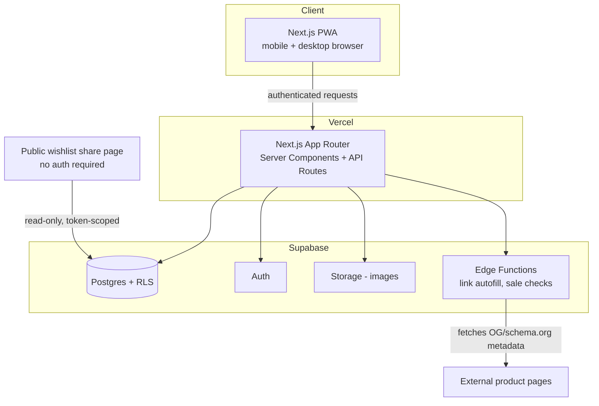

# Architecture

## System Overview

## Multi-Tenancy Model

Every user-owned table (`items`, `wishlists`, `wishlist_items`, custom `categories`/`item_types`) carries a `user_id` column tied to `auth.uid()`. Row Level Security policies enforce that a user can only read/write their own rows — this is enforced at the database layer, so even a bug in application code can't leak cross-user data.

**Write policies must also check what a row _points to_.** Owning the row you insert isn't enough: a reference to another user's row (by UUID) can leak its data through joins or `SECURITY DEFINER` functions, or pin it in place via `ON DELETE RESTRICT`. This bit us twice and is fixed by policy: `wishlist_items` requires owning both the wishlist and the item (KAM-28), and `item_types`/`items` may only reference categories/types that are system or the caller's own (KAM-35). Any new table with a foreign key to user-owned data needs the same check.

System-level defaults (the default Category/Item Type taxonomy) live in the same tables with `user_id IS NULL` and `is_system = true`. Every user sees the system defaults plus any rows they've added themselves. See `DATABASE.md` for the exact policies.

## Public Wishlist Sharing

Shared wishlists must be viewable with **no login**. This is the one deliberate exception to "everything goes through RLS as the authenticated user":

- Each `wishlists` row has a unique, unguessable `share_token`.
- A narrow, explicit RLS policy allows anonymous (`anon` role) `SELECT` on a wishlist and its items **only when the request includes a valid share token**, via a Postgres function (`get_shared_wishlist(token)`) rather than open table access.
- Because that function bypasses RLS, what it returns is only as safe as what can get into `wishlist_items`: the insert policy requires the caller to own **both** the wishlist and the item, so no one can publish another user's item through their own share link.
- The page lives at `/share/<share_token>` (exempted from the login redirect in `lib/supabase/middleware.ts`) and reads only through `getSharedWishlist()` → the RPC. It is `noindex`.
- **What a visitor sees:** list name plus items that are neither purchased nor gifted (title, image, store, price/sale price, link — never the owner's notes; `get_shared_wishlist` returns `notes` as null). An empty list renders a friendly empty state, not a 404; unknown or malformed tokens 404.
- **Gift card ideas** on the share page are computed in the app from fields the share function already returns (store, price, sale price). No extra data is exposed.
- This keeps the "no login to view" requirement without opening the tables themselves to anonymous reads.
- The schema leaves room for an optional, lightweight anonymous identifier (name + a browser cookie) to be added later for reservation-style features, without changing the sharing model itself.

## Link Autofill Flow

1. User pastes a product URL when adding an item.
2. A Supabase Edge Function fetches the page server-side (avoids CORS issues and keeps scraping logic out of the client).
3. The function parses Open Graph tags (`og:title`, `og:image`) and schema.org `Product`/`Offer` structured data where present (title, image, price, sale price).
4. Whatever fields are found pre-fill the add-item form; anything missing (or wrong) is manually editable before saving — autofill is a convenience, never a blocker.
5. Parsing failures fail gracefully to a fully manual entry — never a hard error.

## Sale Detection

- **V1:** price and sale price captured at the time an item is added or manually refreshed by the user (re-running autofill on an existing item). Refresh calls `link-autofill` with `pricesOnly: true` (no image re-download). The decision lives in `lib/price-check.ts` (`applyPriceCheck`): only a _readable_ page updates prices, so a failed read never wipes a known price. Only a lower sale price counts as a sale, and a missing sale price on re-check means the sale ended (it's cleared).
- **V1.5 (built, KAM-43): automatic checks.** `pg_cron` runs **hourly** and calls the `daily-price-check` Edge Function via `pg_net`. Each run checks up to 25 active wishlist items with a link that **haven't been checked in ~20h** (oldest first, 1s between pages, stopping after ~100s), so each item gets checked about once a day and load is spread out.
  - **One write path:** both the manual Check price and the job call the SQL function `record_price_check()`, which logs `item_price_checks` history, stamps `items.price_checked_at`, and only changes prices when a price was read. Cards show "Checked 3h ago".
  - **Sanctioned RLS bypass:** the job uses the service role key, because it checks every user's items. The function is `verify_jwt = false` but refuses any request without the `x-cron-secret` header matching its `PRICE_CHECK_CRON_SECRET` secret; pg_cron reads the same value from Vault. Neither the URL nor the secret is in the repo.
  - Page fetching and extraction are shared by both functions in `supabase/functions/_shared/`.

## Notifications (KAM-54)

- **Alerts are created in Postgres**, by the `notify_price_change()` trigger on items, when `record_price_check()` stamps a check (manual "Check price" included; ordinary edits never alert). Rules and de-duplication: DATABASE.md. Keeping them in SQL means one place decides, whatever triggered the check.
- **Delivery is a daily digest:** pg_cron → `send-push-digest` Edge Function (17:00 UTC, `x-cron-secret`, service role like the price-check job). One push per user per day per device: a single alert as is, several summarized ("3 price alerts", tap → `/notifications`). Unpushed alerts older than 2 days are skipped. Devices answering 404/410 are deleted. Alerts are marked pushed even with no devices, so a device added later doesn't get a backlog.
- **Web Push is hand-written** (`supabase/functions/_shared/web-push.ts`, WebCrypto only): RFC 8291 payload encryption (tested against the RFC's worked example) and RFC 8292 VAPID. No npm web-push: it depends on Node crypto internals.
- **Keys:** the VAPID public key is in `src/lib/push.ts` (public by design; `NEXT_PUBLIC_VAPID_PUBLIC_KEY` overrides). The private key exists only as the Supabase secret `VAPID_PRIVATE_KEY` (plus `VAPID_PUBLIC_KEY`; optional `VAPID_SUBJECT`). Rotating keys invalidates every device subscription.
- **Client:** `/notifications` (list + settings + "Push alerts" toggle); header bell with unread count; the service worker shows pushes and opens their URL on tap. Each device subscribes separately. iPhone: push works only from the Home Screen app (iOS 16.4+), and the toggle says so. Logging out doesn't unsubscribe the device; the next account to turn alerts on there takes it over.

## Category ↔ Item Type Relationship

`item_types` has a required `category_id` foreign key — a category is a property of the item type, not something chosen independently on each item. When a user picks an item type (e.g. "Makeup"), the category ("Beauty") is derived automatically via that relationship, never stored redundantly on the item itself. This is what guarantees the category is always correct and never drifts out of sync.

## Auth & Route Protection

- Supabase Auth (email/password for V1) via `@supabase/ssr`, with separate browser/server clients (`lib/supabase/client.ts`, `lib/supabase/server.ts`) so Server Components, Server Actions, and Route Handlers all read the same cookie-based session.
- `proxy.ts` (Next.js 16's renamed `middleware.ts`) revalidates the session on every request and enforces access by default: everything is protected **except** `/login`, `/signup`, `/auth/*`, the public `/share/*` page, and `/api/health` (keep-alive/uptime check, see TESTING.md) — new routes don't need to opt in to protection, only explicitly opt out.
- An authenticated user hitting `/login` or `/signup` is redirected to `/`; an unauthenticated user hitting a protected route is redirected to `/login?redirectTo=<path>` and sent back there after logging in.
- `handle_new_user` (see `DATABASE.md`) creates the `profiles` row automatically on sign-up — the app never creates it manually.
- **Sign-up:** password + confirm password (min length from `lib/auth.ts`, matching Supabase's `minimum_password_length`), checked live in the form _and_ re-checked in the server action. If Supabase returns a session (email confirmation off, as in local dev), the user goes straight to `/`; "check your email" is shown only when confirmation is actually pending. Password fields have a show/hide toggle (`components/password-input.tsx`).

## Rendering Strategy

- Server Components for data-heavy views (category/item-type group views, totals) — fetch and aggregate close to the database.
- Client Components only where interactivity demands it (filters, multi-select, star ratings, drag-to-wishlist).
- **Loading/error/not-found states:** `app/loading.tsx` (skeleton shown instantly on navigation), `app/error.tsx` (friendly retry screen, reports to Sentry; `global-error.tsx` only covers the root layout), `app/not-found.tsx`, plus a share-specific `share/[token]/not-found.tsx` worded for signed-out visitors. Server-action buttons use `PendingSubmitButton` (disabled while submitting) so slow actions can't be double-fired.
  - Trade-off: because `loading.tsx` makes pages stream, a `notFound()` (missing/foreign item, list, or share token) is a **soft 404** — HTTP 200 with the not-found UI and a `noindex` tag, not a 404 status. Getting a real 404 would mean checking existence in `proxy.ts` before streaming; not worth it for this app.
- **Large lists (KAM-45):** the item list renders at most `ITEMS_PAGE_SIZE` (50) cards, plus "Show more" (`?show=`, which keeps other params). Filtering, sorting, grouping, group counts/totals and Check all prices still run over _every_ matching item; `limitGroups()` caps cards across groups without changing headers. Cards use `content-visibility: auto`. With 300 items (254 on the wishlist) this took the home page from 137 KB / 15.8k DOM nodes / 194 ms blocking time (4× CPU) down to 47 KB / 3.2k / 0 ms.
- **Display rules:** discounts show as whole percents (`displayDiscountPercent`, the stored `discount_percent` keeps 2 decimals); the card's meta line drops a category that just repeats the item type (`itemMetaParts`). Page titles use the root `"%s · Cubby"` template.

## Theming

- Four preferences: `light`, `dim`, `dark`, `system` (default). Logic lives in `src/lib/theme.ts`; palettes are CSS variables in `globals.css`.
- **Dim is a dark-family theme**: `<html>` gets both `.dark` and `.dim`, so Tailwind `dark:` variants still apply and `.dim` only swaps the color tokens. Components should use theme tokens (`bg-background`, `text-muted-foreground`, …), never raw palette colors, so all three palettes stay correct automatically.
- **Stored per device in `localStorage`** (`cubby-theme`), not in the database — no schema/RLS cost, works on logged-out pages (login/signup, public share page). Syncing across devices would mean a `theme` column on a profile table; deferred until there's a reason.
- **No flash**: an inline script in the root layout's `<head>` applies the theme before first paint (per Next's "preventing flash before hydration" guide), so the root layout stays static rather than reading a cookie. `ThemeSync` (client) keeps it correct afterward — OS changes while on System, changes in other tabs, and React's dev-mode remount.
- The inline script is rendered through `components/inline-script.tsx`, a **Client Component** that emits `type="text/plain"` when React renders on the client, so React never sees an executable `<script>` outside the initial HTML parse (otherwise it warns on client-side renders such as Next's not-found recovery).
- PWA/browser chrome color: `viewport.themeColor` defaults to light/dark by OS media query; `ThemeSync` overwrites it with the chosen palette's color (`THEME_COLORS`) after hydration.

## PWA (KAM-51)

- **Service worker** `public/sw.js` (registered in production only by `ServiceWorkerRegister`): page navigations go network-first with `/offline` as the fallback; hashed `/_next/static/` assets are cache-first. **Nothing else is cached** — no user data, API or Supabase responses — so a shared device never shows someone's wishlist offline. Bump `VERSION` to drop old caches. `sw.js` is served `no-cache` with a strict CSP (`next.config.ts`) and skipped by `proxy.ts`.
- **Share target** in `app/manifest.ts` → `GET /items/new?url&text&title`; `sharedLinkFromParams` (`lib/item-form.ts`) pulls the first http(s) link out of `url` or `text` and prefills the autofill field (the user still taps Fetch details).
- **Phone chrome:** `BottomNav` (`sm:hidden`, safe-area padding; hidden on auth/share/offline pages) replaces the header's links on phones; fixed bars (e.g. the selection bar) sit above it with `max-sm:bottom-[calc(4rem+env(safe-area-inset-bottom))]`. `viewportFit: "cover"` lets the app use the full screen under notches.
- **Photo uploads** go through `PhotoInput`, which resizes in the browser (`lib/resize-image.ts`) and swaps the file on the input, so server actions are unchanged.

## Future Extension Points (kept in mind now, not built yet)

- **Closet view (V2):** `items` already has an image; a `closets` table can reference existing items plus new standalone closet photos without restructuring `items`.
- **Native app (V2+):** business logic in `lib/` is framework-agnostic where possible, so it can be shared with a future React Native app.
- **Recommendations (V3):** will need purchase-history and interest-level signals already captured in the V1 schema — no retrofit needed to start collecting the right data.
